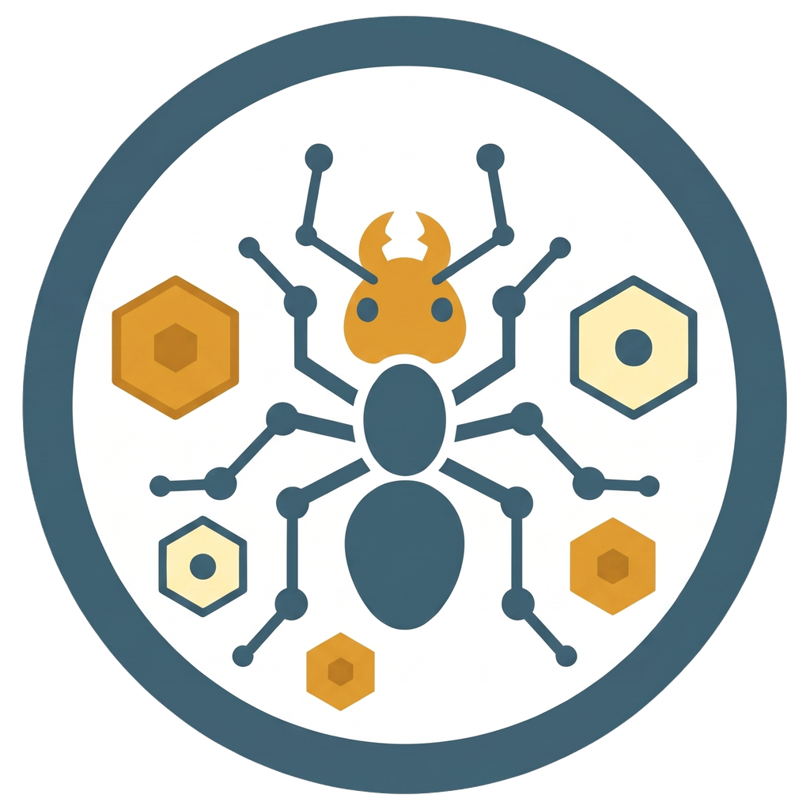
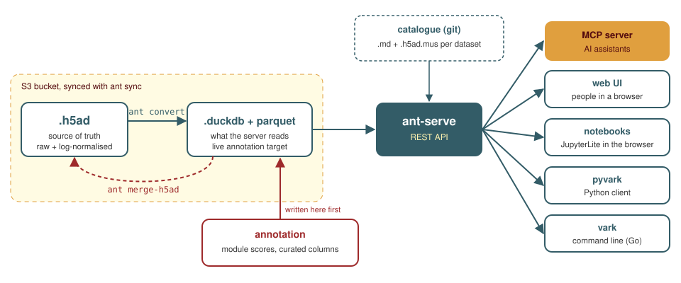

<p align="center"></p>

# anthive

anthive gives an AI assistant curated single-cell RNA-seq data to work
with. Connect Claude, Codex, Gemini CLI, Cursor, VS Code or another MCP
client to an anthive site and ask your question in plain language. Which
microglia datasets show TREM2 changing in Alzheimer's disease? How does a
lysosomal gene set behave across donors? What do the papers behind this
dataset say about its cell types? The assistant finds the datasets, runs
the queries on the server, draws the plots and quotes the papers. Every
number it reports can be checked in the web browser or reproduced from
Python, because all of them come from the same API.

The main deployment holds about 190 datasets in 63 collections, about 17
million cells, mostly human microglia in health and Alzheimer's disease.

---

## What an assistant can do with anthive

The MCP server offers about 45 tools. Grouped by what they are for:

- **Find data.** Search the catalogue by gene, tissue, disease, author or
  free text; read a dataset's design, cell counts and curation caveats.
- **Look at expression.** Genes and gene sets per cluster, condition or
  donor, detection rates, and plots as PNG, SVG or PDF that are clean
  enough for a figure.
- **Compare conditions.** Donor-level comparisons (facets), donor
  variability, module scores (scanpy and UCell) and differential
  expression studies.
- **Ask anything else.** Read-only, sandboxed SQL over the cell metadata
  for questions no tool covers.
- **Read the literature.** Full-text search over the site's paper library,
  linked to the datasets that came from each paper.
- **Contribute.** Upload papers, datasets and analysis results, which
  curators review before they appear.

**Connect in two minutes.** Sign in to an anthive site, open your account
menu, choose **Connect an MCP client** and paste your personal link into
your AI app. [doc/MCP_CLIENTS.md](doc/MCP_CLIENTS.md) has the steps for
about 20 clients. Treat the link like a password; it carries your access.

**Agent skills** teach the assistant anthive's workflows (setup, dataset
analysis, literature, deposits, reproducible reports). They are public at
[github.com/badslab/labskills](https://github.com/badslab/labskills), and
the install guide there covers Claude, Codex, Cursor and others.

Anything anthive returns to your AI client, including text from papers and
datasets, is sent to that client's AI provider. Pick a provider you trust
with that material.

The same data also reaches people through a web browser, code through a
REST API with Python and Go clients, and notebooks through JupyterLite in
the browser. This repository holds all of it: the server, the web UI, the
MCP server, the ingest and annotation tools, the deployment tooling and the
documentation. The other repositories below hold the data catalogue, the
gene sets, the clients and the skills.

---

## What is in it

| Part | What it does | Where |
| --- | --- | --- |
| Web browser | collections, dataset pages, interactive plots, gene atlas, gene-set and module views, differential expression, admin editors | `web/` |
| REST API | datasets, cells, genes, plots (PNG/SVG/PDF), module scores, DE results, sandboxed SQL analytics | `bin/api/ant-serve` |
| MCP server | the same data as tools for AI clients (Claude, Cursor, VS Code, ...), with a private link per user | `bin/api/ant-mcp` |
| Notebooks | JupyterLite in the browser, preloaded with the Python client | `frontend/jupyter/` |
| Data assistant | in-app chat (via OpenRouter); switched off and being phased out, AI use goes through MCP | `lib/chat_*.py` |
| Ingest | check an `.h5ad`, convert it to DuckDB, merge annotations back | `bin/ingest/` |
| Annotation | module scores (scanpy, UCell), curation helpers | `bin/annot/` |
| Catalogue tools | dataset metadata (`.md`, `.h5ad.mus`), validators, gene sets | `bin/meta/` |
| Operations | deployment (`ant-stack`), S3 sync, supervisor | `bin/ops/` |
| Shared core | the DuckDB query layer, plotting, config; used by everything above | `lib/` |

Everything is started through one command dispatcher, `bin/ant`
(`ant convert ...`, `ant sync ...`, `ant score ...`).

## How the data flows

<p align="center"></p>

The `.h5ad` is the long-term source of truth. The `.duckdb` and its parquet
sidecars are what the server reads. Data files live on S3 and are synced
with `ant sync`; dataset descriptions live in git (the `h5adstore` repo).

---

## Deploy a site

Sites run as a docker compose stack from published images, configured by
one `site.yaml`. The step-by-step guide, tested end to end:

**[doc/DEPLOY_CONTAINERS.md](doc/DEPLOY_CONTAINERS.md)**

In short, on a Linux server with Docker and uv:

```sh
git clone https://gitlab.kuleuven.be/bdslab/anthive/anthive4.git && cd anthive4
git checkout v2.48.0
bin/ops/ant-stack init        # writes site.yaml; edit it, then run init again
bin/ops/ant-stack check
bin/ops/ant-stack pull
bin/ops/ant-stack up
```

Read the guide before you start: you also need the catalogue, the data and a
suitable address, and it explains each of those.

Converting data on a compute cluster (no web stack needed):
**[doc/HPC.md](doc/HPC.md)**.

Images (public, linux/amd64):
`registry.gitlab.kuleuven.be/bdslab/anthive/anthive4/anthive-app` and
`.../anthive-ingest`, tagged with the release number.

---

## Use it

- **In the browser:** open the site and log in.
- **From an AI client:** see the top of this page; per-client steps in
  [doc/MCP_CLIENTS.md](doc/MCP_CLIENTS.md), links in
  [doc/MCP_LINKS.md](doc/MCP_LINKS.md).
- **From Python:** [`pyvark`](https://codeberg.org/mfiers/pyvark)
  (`pip install pyvark`, then `from vark import AnthiveClient`).
- **From the shell:** [`vark`](https://codeberg.org/mfiers/vark), a single
  static Go binary for scripting and batch work.
- **Over HTTP:** the API documents itself at `/api/docs` on any site;
  changes per release are in [doc/API_CHANGELOG.md](doc/API_CHANGELOG.md).

---

## The repositories

| Repository | Holds |
| --- | --- |
| **anthive4** (this one): [GitHub](https://github.com/badslab/anthive4), mirrors on [KU Leuven GitLab](https://gitlab.kuleuven.be/bdslab/anthive/anthive4) and [Codeberg](https://codeberg.org/mfiers/anthive) | all code, deployment tooling, documentation; the container images are on the GitLab registry only |
| **h5adstore**: GitHub `badslab/h5adstore`, mirror `gitlab.kuleuven.be/bdslab/anthive/h5adstore` (private) | the dataset catalogue: one `.md` + `.h5ad.mus` per dataset, one `index.md` per collection. No data files. |
| **anthive-genesetdb**: `gitlab.kuleuven.be/bdslab/genesetdbs/anthive-genesetdb` (private) | the gene sets and modules used for scoring |
| **pyvark**: [codeberg.org/mfiers/pyvark](https://codeberg.org/mfiers/pyvark) | the Python client |
| **vark**: [codeberg.org/mfiers/vark](https://codeberg.org/mfiers/vark) | the Go command-line client |
| **labskills**: [github.com/badslab/labskills](https://github.com/badslab/labskills), mirror `gitlab.kuleuven.be/bdslab/anthive/skills` | agent skills for AI apps, also the Claude Team plugin |
| **mus**: [codeberg.org/mfiers/mus](https://codeberg.org/mfiers/mus) | the controlled vocabulary for dataset annotation (`.h5ad.mus`) |

The data files themselves (`.h5ad`, `.duckdb`, parquet) are in an S3 bucket,
not in any repository.

---

## Work on the code

Start with [CLAUDE.md](CLAUDE.md): it explains how the pieces fit together,
and each subfolder has its own `CLAUDE.md` with the details for that part.
The most important rule: `lib/` is shared by every tool and the server, so a
change there affects all of them.

- Every tool in `bin/<area>/ant-*` is a self-contained `uv run --script`
  with its dependencies in its own header; there is no shared virtualenv.
- Tests: `make test`.
- Run the full stack on a development machine without containers:
  `bin/ops/ant-supervisor --caddy` (see [doc/DEVELOPMENT.md](doc/DEVELOPMENT.md)).
- Making a release (version bump, images, tags):
  [doc/RELEASING.md](doc/RELEASING.md).

### Documentation map

| Topic | Document |
| --- | --- |
| deploying a site | [DEPLOY_CONTAINERS.md](doc/DEPLOY_CONTAINERS.md) |
| cluster ingest | [HPC.md](doc/HPC.md) |
| releasing | [RELEASING.md](doc/RELEASING.md) |
| architecture | [ARCHITECTURE.md](doc/ARCHITECTURE.md) |
| DuckDB layout | [DATABASE_SCHEMA.md](doc/DATABASE_SCHEMA.md) |
| checking and converting `.h5ad` | [CHECK_PROCESS.md](doc/CHECK_PROCESS.md), [CONVERT_PROCESS.md](doc/CONVERT_PROCESS.md) |
| dataset metadata files | [METADATA.md](doc/METADATA.md), [METADATA_STRUCTURE.md](doc/METADATA_STRUCTURE.md) |
| writing annotations back | [DESIGN_annotation_updates.md](doc/DESIGN_annotation_updates.md) |
| configuration keys | [CONFIG.md](doc/CONFIG.md), `anthive.default.yaml` |
| API changes | [API_CHANGELOG.md](doc/API_CHANGELOG.md) |
| MCP links | [MCP_LINKS.md](doc/MCP_LINKS.md) |
| connecting each AI client | [MCP_CLIENTS.md](doc/MCP_CLIENTS.md) |
| image internals | [DOCKER.md](doc/DOCKER.md) |
| old host install (no containers) | [DEPLOY.md](doc/DEPLOY.md), [INSTALL.md](doc/INSTALL.md) |

---

## Status

Release **2.48.0** (October 2026). The release number is the REST API
version; a running site reports it at `/api/health`.

Maintained by the BADS lab, KU Leuven (Mark Fiers). License: not yet
specified; ask before reusing the code.
